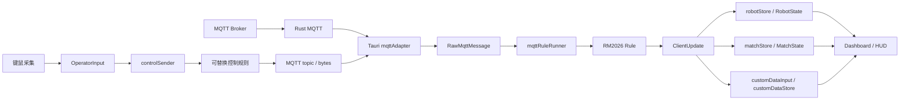

# BNGUClient

基于 [JNU-SHARK/SharkClient](https://github.com/JNU-SHARK/SharkClient) 渐进式重构的 RoboMaster 客户端，使用 Tauri 2、Vue 3、Pinia 和 Rust。

本仓库是本次开发的收尾版本：遥测已切换到新数据链，键鼠采集与 RM2026 编码已分离，原有 HUD 和视频功能保留。它不是已完成官方赛事服务器和实机验收的承诺。上游作者信息和 GPL-3.0 许可证保留；部分二进制名、包名和资源中的 SharkClient 标识暂未改名，以免破坏既有构建和配置兼容性。

## 当前架构



- 入站：只有一条遥测入口，旧 MQTT decoder、worker、mqtt_data 状态链已删除。
- 规则：protobuf、RM2026 编号、单位、队伍顺序、键盘位图和鼠标协议方向在 `src/rules/rm2026/` 内转换。
- 状态：机器人、比赛和自定义数据分别存储；UI 选择不改变 MQTT 路由身份。
- 身份：已建立 MQTT 连接的数字 Client ID 决定本机机器人；StaticStatus 校验身份，不能静默更换身份。
- 操控：内部表达键、鼠标位移和按钮状态，不定义“前进速度”“发射”等机器人动作。具体动作仍由电控实现。
- 视频：独立 UDP 图传链，不经过 MQTT 遥测规则。H.265 在 Rust 侧解码，桌面前端显示本地 MJPEG；并非默认 WebCodecs 解码。

完整边界和生命周期说明见 [架构文档](docs/telemetry-architecture.md)，现场检查见 [交付说明](docs/development-handoff.md)。

## 仓库结构

| 路径 | 职责 |
| --- | --- |
| `src/adaptor/tauri/` | 桌面运行时与 MQTT 原始字节适配 |
| `src/contracts/` | 通用原始消息、增量更新、操作员输入和出站消息契约 |
| `src/rules/` | 通用规则契约；`rm2026/` 实现赛事协议转换 |
| `src/input/` | 遥测分发、连接生命周期、自定义数据解析接入 |
| `src/output/` | 控制输入发送、合并待发送输入、连接切换清理 |
| `src/domain/` | 机器人、比赛和检测领域数据 |
| `src/stores/` | 遥测状态、连接元数据和 UI 选择 |
| `src/store/` | 保留的 Dashboard/HUD 等界面配置状态，不是旧遥测链 |
| `src/composables/` | UI 遥测投影与新鲜度时钟 |
| `src/views/`、`src/components/` | 视图、HUD、输入采集、视频显示 |
| `src-tauri/` | Rust MQTT、UDP 组帧、解码、共享内存与桌面接口 |
| `resources/` | 地图、机器人配置、HUD 模板、自定义协议样例 |
| `UDP-MQTT Server/proto/messages.proto` | 已提交的 MQTT 协议源，生成与 Mock 共用 |
| `tests/` | 遥测、身份、状态、架构边界和操控链回归测试 |
| `tools/robot-state-preview/` | 状态灯和新鲜度 UI 预览，不接真实 MQTT |
| `tools/rm2026-mock-server/` | 独立本地 MQTT / UDP 测试服务 |
| `scripts/`、`.github/workflows/` | 生成、检查、构建、打包和 CI |

## 开发运行

需要 Node.js（CI 使用 20）、npm、当前 stable Rust；Windows 还需要 MSVC C++ 构建工具和 WebView2 Runtime。

```powershell
npm ci
npm run check
npm run tauri -- dev
```

只运行前端：

```powershell
npm run dev
```

Vite 开发地址为 `http://localhost:1420`。纯浏览器模式不具备 Tauri MQTT、UDP 等桌面后端能力；状态预览可以单独查看：

```text
http://localhost:1420/tools/robot-state-preview/?scenario=live
```

Linux 开发需要相应系统依赖：

```bash
sudo apt-get update
sudo apt-get install -y libwebkit2gtk-4.1-dev libgtk-3-dev libsoup-3.0-dev \
  libjavascriptcoregtk-4.1-dev librsvg2-dev patchelf build-essential
npm ci
npm run tauri -- dev
```

## 验证与构建

```powershell
npm run check
npm run build
cargo fmt --manifest-path src-tauri/Cargo.toml -- --check
cargo clippy --manifest-path src-tauri/Cargo.toml --all-targets -- -D warnings
cargo test --manifest-path src-tauri/Cargo.toml
git diff --check
```

`check` 包含 vue-tsc、Node 回归测试和协议引用校验。Vite build 本身不执行类型检查。CI 在 Windows/Linux 执行前端与 Rust 检查。

`npm run build` 只生成 `dist/`，不是桌面安装包。默认桌面构建：

```powershell
npm run tauri -- build
```

原有 lite/mini/single、Linux、Flatpak 打包脚本仍保留。带 `internal-ffmpeg` 的构建须预先生成 FFmpeg 静态库；某些历史打包脚本还要求额外的 ONNX Runtime 等资源。本次收尾不代表所有发行形态均已重新验收。

## 协议源与本地联调

`UDP-MQTT Server/proto/messages.proto` 和 `src/generated/mqtt-proto.json` 均已提交，不需要私有 submodule，也不需要删除 predev/prebuild。修改 MQTT 协议后运行：

```powershell
npm run generate:mqtt-proto
npm run verify:mqtt-proto
```

这是 RM2026 规则的协议，不是电控自定义字节内容的最终定义。后者仍需双方约定。

本地测试服务的启动、Client ID 与视频配置见 [Mock Server 说明](tools/rm2026-mock-server/README.md)。Mock 的采样频率和消息覆盖只用于测试，不是官方服务器能力或实机验收结果。

## 视频与可选 AI

- UDP 默认监听 `0.0.0.0:3334`，解析 8 字节大端分片头，支持 H.265 组帧和 MJPEG。
- H.265 使用 Rust 解码后显示本地 MJPEG。解码队列过载会丢弃积压数据并等待关键帧；CPU/GPU 性能和发送端关键帧配置仍会影响延迟。
- 内嵌 FFmpeg 为可选 feature；外部 FFmpeg 可通过 `SHARK_FFMPEG_PATH` 指定，缺失时有 libde265 软件解码路径。本仓库不附带生成的 FFmpeg 二进制。
- AI 检测是可选外置 Python 服务。上游源码包 `SharkVisionLiteServer-open-source-v1.0.0-20260519.zip` 保留；按其 README 安装依赖。运行期可通过 `SHARK_AI_ROOT` 指定服务目录。
- 测试视频由 FFmpeg testsrc2 生成，不使用赛事视频素材。

## 已知边界

- `src/api-shim.ts` 的 `parseCustomData()` 仍返回 null。原始自定义字节接收和查看可用；依赖解析字段的自定义状态、图片功能未完成。
- 自定义数据输入会合并异步积压、保留最新待解析内容，因此不能直接当作可靠图片分片重组器。
- 自定义控制器串口、MQTT CustomControl 和图传视频是不同接口；没有把它们合成同一种协议。
- K 键菜单中尚未实现的操作仍是占位功能，不能据此认定可以执行机器人动作。
- 地图标定、现场网络、视频延迟、真实电控行为须实机联调。
- QoS 0、松键中立帧和断线队列清理不构成安全停车保证。电控仍须独立实现失联超时和安全状态。

## 上游与许可证

参考原项目：[JNU-SHARK/SharkClient](https://github.com/JNU-SHARK/SharkClient)。本仓库保留上游历史及作者贡献，不是向上游仓库直接发布。

许可证：GPL-3.0，见 [LICENSE](LICENSE)。vendored libde265 等第三方代码保留各自许可证。本地参考副本、`SharkClient.rar`、node_modules 和构建缓存不随本次提交上传。
