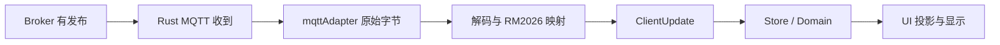

# 调试与排错指南

先完成 [安装与使用](installation-and-usage.md)。本文以当前源码实际入口为准，不新增调试架构，也不建议通过关闭检查来“修复”错误。

## 1. 确认正在运行哪一份代码

在启动程序的终端执行：

```powershell
Get-Location
git status --short
git branch --show-current
git log -1 --oneline
git remote -v
```

自己的发布仓库 origin 应为 afterrain2006/BNGUClient；JNU-SHARK/SharkClient 是参考 upstream。不要在本地 bnguclient-field-test 参考副本或旧 target/release 程序里判断当前改动是否生效。

- VS Code：确认打开的工作区根目录就是正在运行命令的目录。
- Vite 终端：确认实际监听 1420；没有代码热更新记录时检查是否改了另一个副本。
- Rust 终端：确认重新编译完成，未继续运行旧 exe。
- GitHub：确认分支、提交 SHA 与本地一致。git diff 只表示本地改动，不代表已上传；浏览器刷新也不会替你提交或推送。
- 本地开发分支名可能仍为 refactor/bngu-frontend-v1，而发布目标为 origin/main；当前仓库推送时显式使用 `git push origin HEAD:main`，避免推错上游或分支。

不要用 git reset --hard、清空整个工作区或删除全部缓存来掩盖目录问题。

## 2. 日志和开发者工具

### 2.1 前端 Console

1. 在客户端底部“设置”页打开“调试模式”。
2. 返回图传页，必要时按住 Backspace 释放捕获，按 F12 打开 DevTools。
3. Console 关注 startup、MQTT、RM2026、UDP、ControlOutput 和 RobotState DEV 等前缀。
4. Sources 对 TypeScript/Vue 下断点；网络面板中的本地 udp.mjpg 是视频展示流，不是 MQTT Broker。

项目通过 App.vue 的 F12 处理和 api-shim 的 open_devtools 命令打开工具。Tauri 平台还提供 Ctrl+Shift+I 等检查器入口，见 [官方调试说明](https://v2.tauri.app/develop/debug/#webview-console)。右键菜单可能被操控捕获，因此不要只依赖“右键检查”。

Vue 状态断点建议放在 Rule、runner、Store 更新函数与 UI 投影处。不要假设生产页已有一个全局 `robotStore` 变量可以在 Console 直接访问。

### 2.2 Rust 终端

在启动桌面客户端前设置，只影响当前 PowerShell 会话：

```powershell
$env:SHARK_LOG = 'info,shark_client_rust_version_lib::udp_bridge=debug'
$env:RUST_BACKTRACE = '1'
npm run tauri -- dev
```

Linux 等价命令：

```bash
SHARK_LOG=info,shark_client_rust_version_lib::udp_bridge=debug RUST_BACKTRACE=1 npm run tauri -- dev
```

SHARK_LOG 优先，未设置时使用 RUST_LOG，默认 info。先限定模块，不要长期打开全局 trace 或每包日志影响延迟。panic 回溯、编译错误和 tracing 信息看启动终端；前端 Console 不能替代它。

前端 logStore 只保留最近 200 条 log/warn/error，非持久日志。Cache/logs 路径的存在不意味着所有 Rust 输出都会自动保存到文件；需要时保存终端输出并脱敏。

### 2.3 只读状态检查

在已经打开的桌面 DevTools Console 执行：

```javascript
await window.api.mqtt.getStatus()
await window.api.udpStream.getStatus()
```

MQTT 关注 connected、clientId、revision；UDP 关注 running、stats、mjpegStreamUrl。这里检查实际状态，不是设置框未应用的输入值。不要靠 Console 随意发送实机控制命令。

## 3. MQTT：从传输到 UI 分层排查



| 现象/层 | 检查方法 |
| --- | --- |
| MQTT 无法连接 | IP、端口、服务是否启动、Client ID 是否数字、认证条件；本地先 Test-NetConnection |
| 显示连接但无遥测 | 确认是桌面模式，查看 Broker 发布主题、订阅与原始 payload；不要再添加第二个 onMessage 入口 |
| 原始消息有，Rule 无更新 | 在 decoder/index/adapter/telemetry 处断点，检查主题、protobuf、缺失字段和身份校验 |
| 新状态有，UI 无变化 | UI 当前选择是否对应该 robotId；在 useTelemetryView、组件 props 与新鲜度时间上断点 |
| Client ID 改了但路由没改 | 设置框与当前连接分离，需要断开并重新连接 |
| StaticStatus mismatch warning | 比较 payload robotId 和已建立连接的 Client ID，不改成硬编码或 UI 选中 ID |
| 血量是 0 或布尔值 false | 它们是有效值，不应当作没收到；检查是否被 truthy 判断丢弃 |
| 灰色模块灯 | 区分从未收到、超时、断线、重连等待；Mock 默认根本不发送模块消息 |

实际入口文件：src/adaptor/tauri/mqttAdapter.ts、src/input/mqttRuleRunner.ts、src/input/rm2026RuleLifecycle.ts、src/rules/rm2026/、src/stores/robotStore.ts、src/composables/useTelemetryView.ts。

`main.ts` 开发模式下有按秒合并的 RobotState DEV 日志，但快照只包含部分字段，并且 console.debug 可能被日志级别过滤；不能因为这个摘要没展示模块就认定模块不存在。

## 4. 操控链：验证输入，不替电控定义动作

链路为 RoboControl → OperatorInput → controlSender → 控制 Rule → mqttAdapter → Rust MQTT。

先连接本地 Mock，关闭 Dashboard 菜单，进入捕获后按键/移动鼠标，在 Mock 终端查 RX CONTROL：

- KeyboardMouseControl 是否收到；W/S/A/D 位图是否符合当前规则。
- 浏览器鼠标正 Y 与协议 Y 方向在 Rule 内转换；不要在 UI 再反转一次。
- 松开按键后键位是否归零；按住 Backspace、打开菜单或失焦后检查释放行为。
- 断开重连时旧待发送输入是否取消，不将 UI 选择当发送身份。

不要继续使用旧版 `shark.dashboard.roboControlDebug` localStorage 开关期待输出；发送链拆分后已无该旧日志功能。可在 controlSender/Rule 下断点或查看 Mock 端实收。

MQTT 成功发布只表示传输层接受请求，不证明机器人收到、执行或安全停止。实机的输入映射和失联超时仍须与电控联调。

## 5. 视频：区分收包、组帧、解码和展示

MQTT 正常不代表 UDP 画面正常；本地 MJPEG HTTP 有连接也不代表正在收到新的 UDP 视频。

1. 先确认 UDP 已启动、监听端口为 3334、发送目标是客户端 IP，不是 Broker IP。
2. 统一 IP 还用于 sourceHost 过滤：本地 Mock 用 127.0.0.1，真实设备用实际源地址；来源不符会被过滤。
3. 在 UDP 状态 stats 检查 totalBytes（接收量）、assembledFrames（完整组帧）、decodedFrames（解码输出）、droppedIncompleteFrames、decodeQueueDepth 和 decoderWaitingKeyframe。
4. 接收量在增长但无完整帧，检查 8 字节分片头、分片索引、帧长与丢包；不能把任意裸 H.265 UDP 数据报当该协议。
5. 完整帧存在但无解码输出，核对 HEVC 格式、参数集/关键帧、日志中的解码后端与队列状态。
6. 解码正常但黑屏，检查 DevTools 中本地 udp.mjpg 请求、img 元素状态和缩放；不要改 MQTT Rule 修视频。

只在本地模拟网络问题：

```powershell
npm run dev --prefix tools/rm2026-mock-server -- --packet-loss 0.01 --jitter 10 --reorder 0.01
```

不在正式比赛网络上注入丢包。恢复应检查下一关键帧与队列追新行为，不要求每帧都保留。

## 6. 端口和环境排错

PowerShell 只读检查：

```powershell
Test-NetConnection 127.0.0.1 -Port 3333
Get-NetTCPConnection -LocalPort 1420 -ErrorAction SilentlyContinue
Get-NetTCPConnection -LocalPort 3333 -ErrorAction SilentlyContinue
Get-NetUDPEndpoint -LocalPort 3334 -ErrorAction SilentlyContinue
```

Test-NetConnection 检查 TCP，不能证明 UDP 3334 的视频内容有效。发现占用先看 OwningProcess 并确认进程归属，不盲目结束所有 Node/客户端进程。

| 错误/现象 | 处理方向 |
| --- | --- |
| npm.ps1 无法加载 | 可用 npm.cmd 执行相同命令；不要永久关闭系统脚本策略 |
| 找不到 rustc/cargo/npm | 重开终端、检查 PATH 与安装，别改源码绕过工具缺失 |
| linker/link.exe、windows.h 等缺失 | 补 MSVC C++ 工作负载与 Windows SDK，检查是否 MSVC 工具链 |
| 缺少 WebView2 | 按 Tauri 环境说明安装 Runtime |
| Linux 找不到 webkit2gtk-4.1/pkg-config | 安装本发行版开发包；不要用 Windows 依赖目录 |
| 1420 已占用 | 检查是否既运行 tauri dev 又另开 Vite，保留一套正确进程 |
| 3333 bind/address in use | Mock 与内置 Broker 不要同时占同一端口 |
| 浏览器报 IPC/API 不可用 | 纯网页不是桌面客户端；用 tauri dev 或专用 UI 预览 |
| 找不到 messages.proto | 检查是否克隆了正确仓库/完整目录；协议源已提交，不要删 prebuild 绕过 |
| zip 无法解压 | 检查是否 LFS 指针；AI 可选，不阻碍基础联调 |
| 改 XML/YAML 无效果 | 核对实际运行副本、资源解析路径和是否已重读/重启，不假设所有资源有 HMR |
| 自定义状态或图片没解析 | parseCustomData 仍为 null，占位功能不是网络或依赖问题 |

Cache 默认位于程序目录的 Cache，可由 SHARK_CACHE_DIR 覆盖，WebView 状态/设置可能跨启动保留。先备份并定位具体配置，别先删除整个 Cache；不建议为了一个显示问题重置全部配置。

## 7. 自动检查和 GitHub CI

在仓库根目录执行：

```powershell
npm run typecheck
npm test
npm run verify:mqtt-proto
npm run build
cargo fmt --manifest-path src-tauri/Cargo.toml -- --check
cargo clippy --manifest-path src-tauri/Cargo.toml --all-targets -- -D warnings
cargo test --manifest-path src-tauri/Cargo.toml --no-fail-fast
git diff --check
```

也可用 npm run check 合并前三项；Vite build 不执行 vue-tsc。Mock 独立检查：

```powershell
npm run typecheck --prefix tools/rm2026-mock-server
npm test --prefix tools/rm2026-mock-server
```

单独跑一个客户端测试可用 `node --test tests/control-output.test.mjs`。测试文件使用 esbuild 加载实际 TypeScript，不只测模拟接口。

GitHub Actions 中选择提交对应的 CI，展开失败 job/step，查看第一条真实 error、文件行号和工具链版本；不要只看最后一句 Process completed with exit code。绿色前端任务不能代替 Rust 编译和打包验收。

首次上传提交 7b1ad1b 的两项 Rust CI 都因 mjpeg.rs 的 AtomicUsize.fetch_update 弃用警告被 -D warnings 提升为错误。此处改用 try_update，保留相同闭包与内存序，不通过关闭 warnings 或重写业务链处理。新结果须看新提交的 CI，旧提交的红叉不会自动消失。

CLI 可辅助查看（需 GitHub CLI 已登录）：

```powershell
gh run list --repo afterrain2006/BNGUClient --limit 5
gh run view RUN_ID --repo afterrain2006/BNGUClient --log-failed
```

## 8. 提交问题时附哪些信息

附操作系统、Node/npm/Rust 版本、提交 SHA、启动命令/目录、实际连接参数、是否 Mock、复现步骤、预期/实际表现、第一条错误与相关堆栈。

涉及视频再附编解码后端、收包/组帧/解码统计；涉及身份再附脱敏 Client ID 与消息 robotId。不要附密码、访问令牌、完整个人目录、无关聊天记录或整份 node_modules/target。没有实机验收记录时明确写“仅本地/Mock 验证”。
