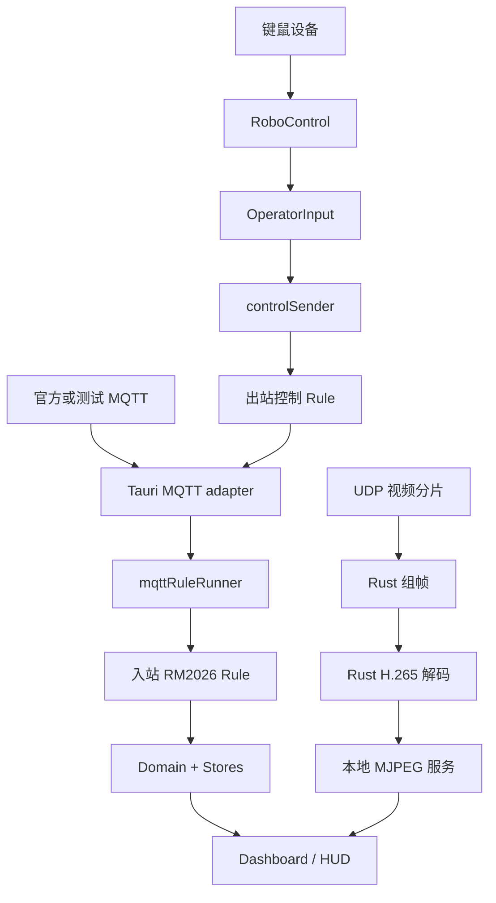

# 本次开发交付说明

这是 BNGUClient 渐进式重构的开发收尾版本，发布源码和验证工具，不宣称已完成赛场验收。

## 已完成

- 删除旧 mqtt_data、MQTT Worker / PayloadDecoder / mqtt_protocol 入站链，UI 从新状态读取。
- RM2026 规则将协议转换为 RobotUpdate、MatchUpdate 和 CustomDataUpdate。
- 本机身份来自已建立连接的 Client ID；UI 当前选择与连接身份独立。
- 静态、动态、模块、位置、全局血量、比赛状态、队伍经济、机制、增益、事件及相关专用状态接入新链。
- 模块灯和血量区分未收到、有效、过期、断线和重连等待；零值与 false 不会被当成缺失字段。
- 保留既有 HUD/XML/YAML 绑定路径，通过只读投影读取新 Domain。
- 键鼠内部输入不携带 RM2026 位图；当前规则负责一一对应映射和 protobuf 编码。
- 控制发送保留单个在途任务和合并待发送输入；退出捕获用中立帧替换积压，断线和卸载取消未提交任务。
- 主入口保存监听清理函数，并在 HMR dispose 时释放；Dashboard 不再重复注册遥测入口。
- 提供状态预览、本地 Mock、前端回归测试和 Windows/Linux CI。

## 三条独立链



`mqttRuleRunner` 负责入站分发，不承担所有出站操作，也不解码视频。赛事协议映射由 Rule 做，运行时传输由 Adapter 做，状态更新由 Store 做。

## 以后替换控制规则

1. 保留 `OperatorInput`（按键 code、浏览器方向鼠标位移、滚轮步数和按钮），不把电控动作塞进 UI。
2. 实现 `MqttControlRule`：提供采集策略和 `encode(input)`，返回 topic、bytes、QoS 和 retain。
3. 在 `src/output/clientControlOutput.ts` 的组合点选择新规则；不必改 RoboControl 或 robotStore。
4. 用测试确认键码、鼠标方向、松键帧以及断线语义，与电控约定字节内容和失联超时。

这个接口适用于更换 MQTT 控制编码。直接接串口的自定义控制器需要独立设备 Adapter，把输入转换为相同 `OperatorInput` 后复用发送链；不能把串口包当 MQTT protobuf 包，也不必绕道入站 mqttRuleRunner。

普通 MQTT 命令面板仍通过兼容 API 和 RM2026 公共编码器发送协议命令。本阶段隔离的是键鼠操控链，没有声称所有命令都已转换成通用输入。

## 未完成或须现场确认

- `parseCustomData()` 仍为 null 占位：电控尚未确定最终字节布局，不能猜字段实现解析。
- 自定义图片的格式、分片、丢包处理和展示未完成。当前合并积压策略只适合最新状态，不适合直接重组图片。
- K 键菜单中部分操作仅记录日志。图传视频与自定义图片不是同一条输入链。
- 原始数据能看见不等于业务字段能正确解析；Mock 测试通过不等于真实机器人安全可控。
- 已提交给底层 MQTT 的消息无法撤回。QoS 0 和释放帧都可能丢失，电控必须独立做超时保护。
- 保留上游的打包脚本和名称，没有对所有可选 FFmpeg/AI/安装包配置逐一验证。
- 本机 Windows 检查不等于 Linux 运行验收；跨平台检查交由 CI 补充。

## 现场联调清单

1. 检查 Broker 地址、端口、Client ID 与机器人编号，不以 UI 选择推断本机身份。
2. 验证 StaticStatus 正常到达；身份不匹配时有 warning 且不更新错误机器人。
3. 观察 DynamicStatus、ModuleStatus、Position 与全局血量的更新，确认红蓝映射及位置单位。
4. 断开重连后确认旧状态不被当作新报告、模块灯重新等待新消息。
5. 先架空或禁用执行机构，核对 W/S/A/D、修饰键、鼠标方向与松键数据，再确认电控动作。
6. 测试失焦、菜单打开、退出捕获及断网；确认机器人端独立超时保护。
7. 测试 UDP 画面、关键帧恢复、丢包与端到端延迟，校准地图坐标。
8. 电控协议确定后单独实现和验收自定义数据解析，不将当前样例配置视为最终协议。

## 复现验证

```powershell
npm ci
npm run check
npm run build
cargo fmt --manifest-path src-tauri/Cargo.toml -- --check
cargo clippy --manifest-path src-tauri/Cargo.toml --all-targets -- -D warnings
cargo test --manifest-path src-tauri/Cargo.toml --no-fail-fast
git diff --check
```

Mock 独立依赖安装与验证：

```powershell
cd tools/rm2026-mock-server
npm ci
npm test
npm run typecheck
```

本次提交排除本地参考副本 `bnguclient-field-test/`、`SharkClient.rar`、依赖目录和构建缓存。上游原有的 AI 源码发行包与 Git 历史保留。
