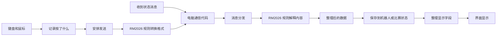

# 项目目录导航

这份目录按“要改什么，去哪里找”组织。这里只是在给文件分类，不要求你掌握一套架构术语，也没有增加一堆要分别安装的子项目。安装和使用先看 [一步一步跑起来](installation-and-usage.md)。

文中的路径都从项目根目录算起。例如项目在 `D:\projects\BNGUClient`，`src/pages/Cockpit.vue` 就是 `D:\projects\BNGUClient\src\pages\Cockpit.vue`。资源管理器可直接粘贴这个完整路径；VS Code 可按 Ctrl+P，输入 `src/pages/Cockpit.vue` 打开。

## 一眼看懂项目

```text
BNGUClient/
├─ rules/                         具体赛事/队伍协议
│  └─ rm2026/
│     ├─ index.ts                 客户端从这里使用 RM2026 的功能
│     ├─ defaults.ts              默认 MQTT 连接与订阅主题
│     ├─ decoder.ts               protobuf 解码
│     ├─ adapter.ts               把协议里的字段变成机器人状态
│     ├─ telemetry.ts             把比赛等报告变成程序里的数据
│     ├─ control.ts               键鼠输入编码规则
│     ├─ commands.ts              普通命令编码
│     ├─ types.ts                 协议内部字段类型
│     ├─ proto/messages.proto     唯一协议源文件
│     └─ generated/mqtt-proto.json 生成文件，不手改
├─ core/                          大家共用的定义，不包含某年比赛的特殊规则
│  ├─ models/robot/               机器人状态与效果
│  ├─ models/match/               比赛状态
│  ├─ contracts/                  消息和按键等数据应该长什么样
│  └─ rules/types.ts              每套规则要提供哪些方法
├─ src/                           客户端 TypeScript / Vue 源码
│  ├─ main.ts                     启动入口
│  ├─ env.d.ts                    全局类型
│  ├─ app/                        主菜单、选择规则、管理每次连接
│  ├─ pages/                      四个完整页面
│  ├─ ui/                         页面内的组件，按用途分类
│  ├─ communication/              MQTT、自定义字节输入和控制发送
│  ├─ state/                      唯一的客户端状态目录
│  │  ├─ telemetry/               机器人、比赛、连接和自定义数据
│  │  └─ ui/                      显示对象选择、HUD 偏好、消息和日志
│  ├─ telemetry/                  把收到的数据整理成界面要显示的值
│  ├─ config/                     默认设置和读取配置文件的辅助代码
│  ├─ desktop/                    把界面操作连接到电脑端功能
│  └─ assets/                     CSS、字体和内嵌静态资源
├─ src-tauri/                     Rust 桌面后端，保留工具默认位置
├─ public/                        网页静态资源，保留 Vite 默认位置
├─ resources/                     程序运行配置与模板，保留既有读取路径
├─ tools/                         Mock 和状态灯预览
├─ tests/                         自动回归与目录/依赖边界检查
├─ scripts/                       协议生成、检查和构建命令
├─ docs/                          使用、调试、架构和交付文档
└─ .github/workflows/             GitHub CI
```

`dist`、`node_modules`、`src-tauri/target` 是自动生成的文件或下载的组件，不是平时修改代码的地方，也不应整份上传 GitHub。小工具自己的 `src`、`test`，以及 Rust 的目录保持它们原来的用法。

## 要改什么，去哪里

| 要做的事 | 首先查看 |
| --- | --- |
| 菜单、快捷跳转、HUD 呈现方式 | `src/app/App.vue` |
| 操作视野、图传展示及现有设置弹窗 | `src/pages/Cockpit.vue` |
| 遥测页面和快照导出 | `src/pages/Telemetry.vue` |
| 自定义数据页面 | `src/pages/CustomData.vue` |
| 全屏快捷键、调试开关、退出 | `src/pages/Settings.vue` |
| 紧凑 HUD、机器人状态显示 | `src/ui/cockpit/` |
| 鼠标键盘采集、购买菜单、普通命令面板 | `src/ui/control/` |
| HUD 编辑、拖拽、绘图 | `src/ui/hud/` |
| 小地图、姿态、热量等 HUD 组件 | `src/ui/hud/widgets/` |
| 数据条、数字、环形等通用 HUD 样式 | `src/ui/hud/styles/` |
| 消息窗口与列表 | `src/ui/messages/` |
| 视频来源、机器人模式、准星等配置组件 | `src/ui/settings/` |
| 图标、标题栏、通用按钮/确认弹窗 | `src/ui/shell/`、`src/ui/common/` |
| MQTT 原始收发与消息分发 | `src/communication/mqtt/` |
| 按键怎样发送、松开后怎样归零 | `src/communication/control/controlSender.ts` |
| 更换按键发出去时使用的协议 | `src/app/clientControlOutput.ts` |
| 断线或换编号时怎样停掉旧连接的数据处理 | `src/app/rm2026RuleLifecycle.ts` |
| 队伍自定义字节的解析接入 | `src/communication/custom-data/` |
| RM2026 消息字段、身份范围、键位编码 | `rules/rm2026/` |
| 规定程序里的机器人状态、按键数据有哪些字段 | `core/models/`、`core/contracts/` |
| 更新状态、读取连接信息 | `src/state/telemetry/` |
| 显示对象、HUD 偏好、面板位置 | `src/state/ui/` |
| 修改界面字段如何读取机器人状态 | `src/telemetry/useTelemetryView.ts` |
| 修改机器人配置或 HUD 模板内容 | `resources/`，不是 `rules` |
| UDP 组帧、H.265 解码、本地 MJPEG | `src-tauri/src/`，不经过 MQTT Rule |

`Cockpit.vue` 就是原来的 Dashboard 页面，现有函数、组件绑定、配置格式与按键没有因文件改名而改写。暂不拆分其内部逻辑；目录整理不等于重新实现所有功能。

## 文件之间怎样合作

下面的箭头表示“使用谁的代码”，不是数据流动方向：

```text
src 客户端 ───→ rules/rm2026 ───→ core
     └────────────────────────→ core
```

- `core` 只写共用定义，不碰窗口、网页界面或某年的比赛格式。
- `rules` 可以使用这些共用定义，但不能反过来读取客户端内部文件。
- 客户端从 `rules/rm2026/index.ts` 这个入口使用协议，不到处引用内部解码文件。
- `src/state` 保存整理后的数据，不直接拆 RM2026 的原始消息。切换显示机器人不会改变收到的消息属于谁。
- 代码里的 `@/` 是 `src/` 的简写，`@core/` 是 `core/` 的简写，`@rules/` 是 `rules/` 的简写。它们不是磁盘上三个叫 @ 的文件夹。

实际数据链保持不变：



## 常见旧路径对照

| 旧位置 | 新位置 |
| --- | --- |
| `src/rules/rm2026/` | `rules/rm2026/` |
| `src/domain/` | `core/models/` |
| `src/contracts/`、`src/rules/types.ts` | `core/contracts/`、`core/rules/types.ts` |
| `UDP-MQTT Server/proto/` | `rules/rm2026/proto/` |
| `src/generated/` | `rules/rm2026/generated/` |
| `src/App.vue` | `src/app/App.vue` |
| `src/views/Dashboard.vue` | `src/pages/Cockpit.vue` |
| `src/views/CustomDataConfig.vue` | `src/pages/CustomData.vue` |
| `src/views/Telemetry.vue`、`Settings.vue` | `src/pages/` 下的同名文件 |
| `src/components/` | 按用途归入 `src/ui/` |
| `src/store/`、`src/stores/` | 合并归类到 `src/state/` |
| `src/adaptor/tauri/` | `src/communication/mqtt/` |
| `src/input/`、`src/output/` | 通信逻辑归 `src/communication/`；规则组装归 `src/app/` |
| `src/composables/` | `src/telemetry/` |
| `src/api-shim.ts`、`src/shims/` | `src/desktop/api.ts`、`src/desktop/shims/` |
| `src/utils/`、`src/types/` | 配置辅助归 `src/config/`；自定义 protobuf 编码归 `src/communication/custom-data/` |

迁移后如果 VS Code 还开着旧文件标签，请从新目录重新打开；不要把旧标签当成磁盘上仍有第二份源码。没有保留旧路径的转发壳或重复 Store。

## 验证与后续扩展

根目录仍执行 `npm run check`、`npm run build`、`npm run tauri -- dev`。修改 RM2026 proto 后执行 `npm run generate:mqtt-proto`；生成 JSON 和唯一 proto 源一起提交。Mock 使用同一 proto，不另抄一份。

以后有新的比赛或队伍协议，就在 `rules` 增加对应代码，再让 `src/app` 选择它。直接插串口的控制器要有自己收数据的部分，不能拿它的字节直接冒充 MQTT 消息。自定义字节解析和图片拼接仍未完成，换个文件夹不会自动获得这些功能。
