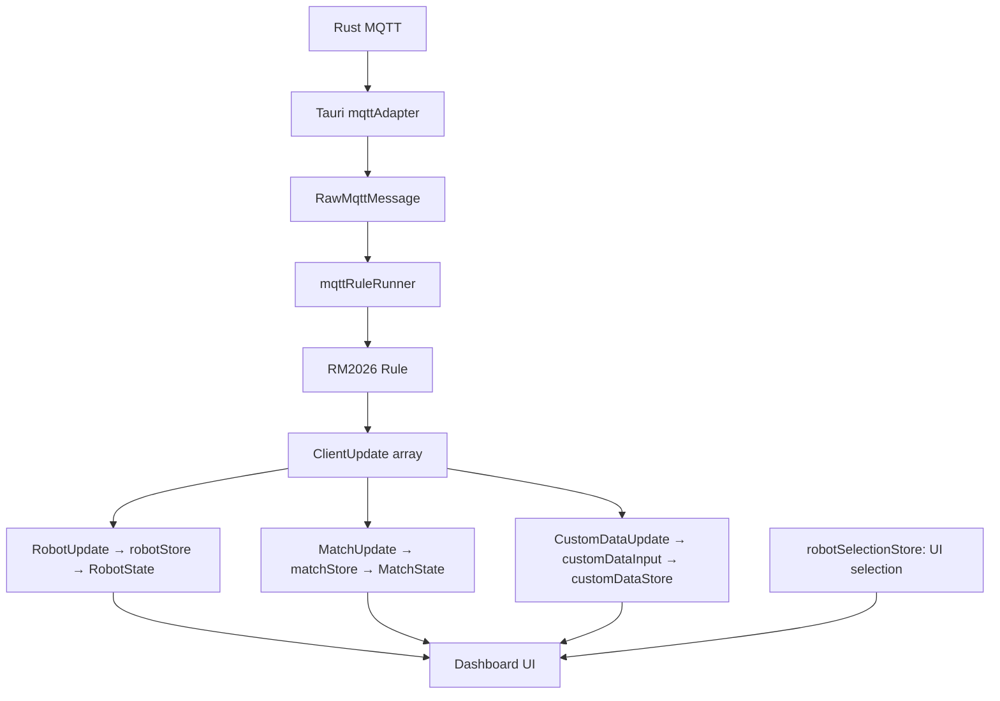

# Client telemetry after the old-chain migration

There is one MQTT telemetry ingress. Dashboard no longer owns decoding or message
dispatch. Runtime adapters normalize transport data; RM2026-specific decoding and
mapping are private to `src/rules/rm2026/`.

## Boundaries

- `src/adaptor/tauri/mqttAdapter.ts`: MQTT operations, Tauri events, byte
  normalization, single/batch messages exposed as individual raw messages.
- `src/rules/types.ts`: runtime-independent `MqttRule` and `MqttControlRule` contracts.
- `src/rules/rm2026/index.ts`: public RM2026 factory, Client ID parsing and command
  encoding exports. Consumers do not import its implementation files.
- `src/rules/rm2026/decoder.ts`, `adapter.ts`, `telemetry.ts`, `commands.ts`, `control.ts`:
  protobuf, protocol IDs, units, team ordering and command serialization.
- `src/contracts/RobotUpdate.ts` and `ClientUpdate.ts`: incremental application
  updates. Robot routing remains `robotId`; match data is not a fake robot.
- `src/stores/robotStore.ts`: robot state, partial updates and field receipt times.
- `src/stores/matchStore.ts`: game status, team economy/base/outpost state,
  mechanisms, events, rune and radar observations.
- `src/input/customDataInput.ts`: user-defined asynchronous content parsing,
  keyed by incoming robot ID, with coalescing and session cancellation.
- `src/stores/robotSelectionStore.ts`: configured UI name/ID selection. Changing
  selection neither clears telemetry nor changes the MQTT connection identity.
- `src/stores/connectionStore.ts`: connection metadata and ingress counters.
- `src/composables/useTelemetryView.ts`: read-only projections for Dashboard and
  existing XML/YAML binding paths. It owns no decoded state or MQTT listener.

## Identity and lifecycle

The established MQTT connection's active Client ID determines RM2026 `selfRobotId`.
The Rule instance keeps that ID immutable. StaticStatus is validated against it;
it cannot change session identity or UI selection. DynamicStatus, ModuleStatus,
InjuryStat, RespawnStatus and PenaltyInfo use the bound session ID. Position and
Buff use their own explicit payload ID; radar identity comes from documented
ordered slots. Ally/enemy values are converted into absolute red/blue team state
inside Rule.

`src/input/rm2026RuleLifecycle.ts` replaces listeners when identity changes and
stops them on disconnect/disposal. Old pending callbacks and custom parse results
cannot write into the new session. Robot health/module/position reports are
invalidated, remote-action permissions cleared, and match/custom state reset.
History values are not republished as new reports.

## Removed

- AI detection components, Python service, shared-memory bridge, model archive,
  placeholder WebRTC distribution and legacy AI packaging variants. The product
  is BNGUClient; UDP video decoding remains independent of telemetry and AI.
- `src/store/modules/mqtt_data.ts`
- `src/mqtt/mqttDecoder.worker.ts`
- `src/mqtt/mqttPayloadDecoder.ts`
- `src/utils/mqtt_protocol.ts`
- `src/utils/mqtt_protocol_constants.ts`
- The api-shim incoming MQTT queue/listeners and Dashboard decoded-message pump.

The rest of `api-shim.ts` remains for existing desktop APIs and command panels;
it is not a second telemetry chain. Command serialization is now delegated to
RM2026's public codec without adding ControlIntent or electrical-control actions.

## Operator input and outgoing control

`RoboControl.vue` captures browser key codes, raw mouse deltas and button states as
`OperatorInput`. Capture rate and accepted keys come from the selected Rule policy.
The RM2026 control Rule owns keyboard bits, Y/wheel sign conversion, int32 limits,
protobuf bytes and MQTT options. UI no longer encodes these wire fields.

`Dashboard → controlSender → MqttControlRule → OutboundMqttMessage → mqttAdapter`
is separate from the telemetry runner. `src/output/clientControlOutput.ts` is the
composition point for switching the MQTT control Rule. Other command panels remain
protocol-aware compatibility clients; they are not claimed as migrated input sources.

The sender coalesces accumulated relative motion with latest key/button state,
keeps one active send, and cancels queued/encoding work on disconnect or disposal.
An already submitted transport publish cannot be revoked. Forced release replaces
pending motion but is not a substitute for robot-side communication timeout safety.

## Preserved binding paths and limits

Existing paths such as `robot.blue.103.currentHealth`, `currentRobot.currentHeat`,
`gameStatus.currentStage`, `penaltyInfo.penaltyEffectSec`, `injuryStats.103.totalDamage`
and module numeric indicators remain readable through UI projections. The Domain
uses semantic stages, module availability, buffs and penalty kinds; display codes
exist only for persisted UI configuration compatibility. `robotType` now displays
the configured type name, not an undocumented wire type number.

The existing desktop `parseCustomData()` API is still a null-returning placeholder.
Receiving a custom stream is implemented, including raw byte inspection; arbitrary
user binary fields/image decoding is not claimed as implemented. A real parser can
be injected into `createCustomDataInput` without changing telemetry Rule or stores.

This migration is verified with `npm run check` (typecheck, tests and proto checks),
`npm run build`, Rust formatting/static/tests checks, and Git
whitespace/dependency checks. Automated protobuf-to-state tests are not a substitute
for field testing against an official referee-system MQTT server.
